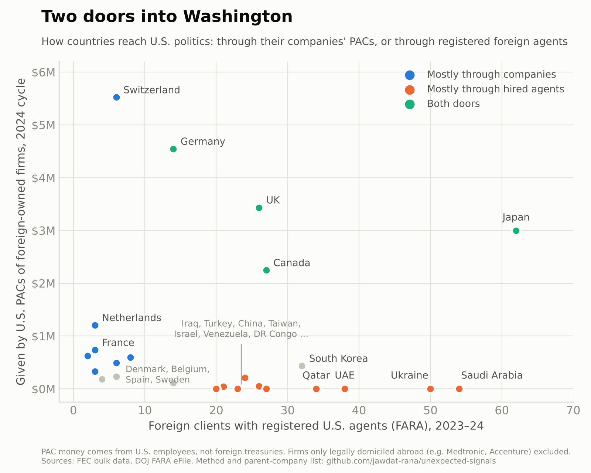

The U.S. midterms just ended, and "foreign money in elections" is back in the headlines. So I looked at the public data. First, the legal point: foreign nationals and governments can't donate to U.S. campaigns. They have two legal ways to influence Washington instead.

**Door 1: companies.** A foreign firm's U.S. subsidiary can run a PAC, funded by its American employees. **Door 2: hired agents.** Governments, state companies and parties hire registered U.S. lobbyists and PR firms, and have to disclose it under the Foreign Agents Registration Act (FARA).

{{ signal value="$24M" label="given in the 2024 cycle by about 110 PACs of foreign-owned companies. UBS's U.S. PAC alone gave $2.9M." }}

## Door 1: the company PACs

Swiss, German, British and Japanese firms lead. The Netherlands is sixth, through six PACs: Aegon (Transamerica), Airbus, Philips, Heineken, Ahold Delhaize and CNH Industrial.

{{ chart src="charts/pac-bars.js" data="data/pac_money_by_country_2024.csv" title="Swiss and German companies' PACs gave the most" subtitle="Contributions from U.S. PACs of foreign-owned companies to other committees, by parent company's country, 2024 cycle" source="FEC bulk data, own matching of PACs to foreign parents" note="Excludes firms only legally domiciled abroad, such as Medtronic and Accenture." }}

## Two doors, two kinds of economy

When you put each country on both axes, the countries don't land in one cloud. They split by which door they use.

- Switzerland, the Netherlands and France go almost entirely through companies. The Netherlands has $1.2M through PACs and just 3 FARA clients.
- Saudi Arabia, the UAE, Qatar and Ukraine go through agents: dozens of FARA clients and almost no PAC money.
- Japan, the UK, Germany and Canada use both.

The pattern follows how each economy is built. Countries with big private multinationals end up in U.S. politics through their employees. Countries without big U.S. subsidiaries, often where the state runs the economy, hire lobbyists instead.

## What this doesn't show

- PAC money comes from Americans, and as a group these PACs give to both parties. OpenSecrets puts 2024 at roughly 42% Democratic and 58% Republican.
- FARA counts clients, not dollars. The bulk data has no amounts.
- Ukraine's FARA count is wartime lobbying, which is its own story.

## How I did it

I matched FEC corporate PACs to a hand-made list of foreign parent companies, then totalled each PAC's contributions to other committees by the parent's country. FARA clients are counted per country for 2023 and 2024. The parent list and the code are in the repo.

Part 2 looks at the other side: American donors who give to foreign-policy and diaspora PACs, counted with the same method.
